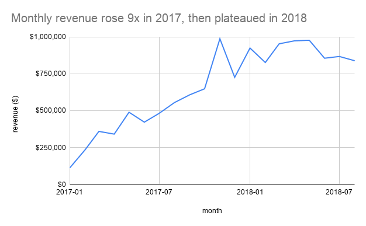
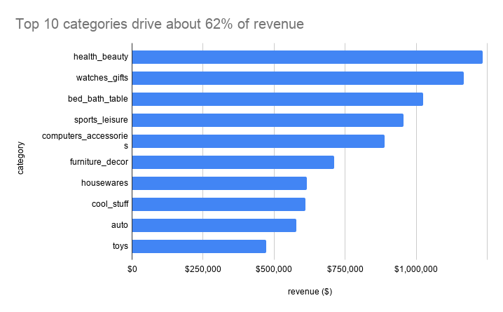
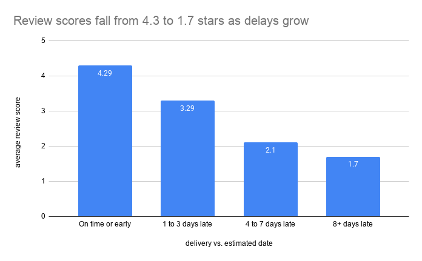
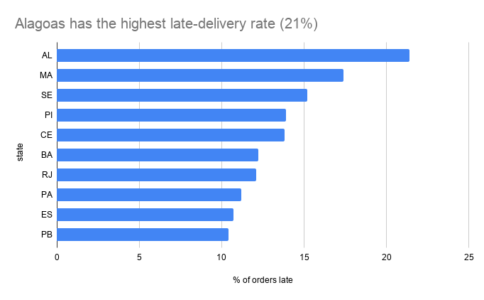

# Olist E-Commerce Analysis (SQL)

## Summary
- Revenue grew about 9x in 2017 and then flattened. Growth came from more orders, not bigger orders.
- São Paulo drives 38% of revenue, and the top 10 categories make up about 62%.
- Late deliveries (6.8% of orders) cut review scores from 4.29 to 2.27 stars, and the longer the delay, the worse the score.

**Skills shown:** SQL (BigQuery), joins, CTEs, window functions (ROW_NUMBER, RANK, LAG), data cleaning, data visualization, business recommendations.

## Business question
Which product categories and states drive revenue, and do late deliveries lower customer review scores?

## Data
Olist Brazilian E-Commerce Public Dataset (Kaggle), about 99K orders from Sept 2016 to Oct 2018.
Tables used: orders, order_items, order_reviews, customers, products, category_translation.
Revenue is defined as the sum of item price, excluding shipping (freight).

## Tools
BigQuery (SQL), Google Sheets for charts.

## Data cleaning notes
- Kept only orders with status `delivered` and a delivery date (about 97% of orders). This excludes 8 delivered orders with no delivery date and all orders never delivered (shipped, canceled, unavailable, invoiced, processing).
- order_reviews has about 800 duplicate review_ids, and 547 orders have 2 to 3 reviews. Kept the most recent review per order.
- category_translation loaded with its header as a data row; rebuilt the table with correct column names (71 categories).

## Analysis
| File | Question |
| --- | --- |
| 00_fix_category_translation.sql | Fixes header row loaded as data in the category table |
| 01_explore_orders.sql | Row counts, order statuses, date range |
| 02_data_quality_checks.sql | Table counts, missing delivery dates, duplicate reviews |
| 03_monthly_revenue.sql | Monthly revenue, orders and average order value |
| 04_top_categories.sql | Top 10 product categories by revenue |
| 05_revenue_by_state.sql | Revenue, orders and average order value by customer state |
| 06_delivery_delays.sql | Late delivery rate and delivery time, overall and by state |
| 07_reviews_late_vs_ontime.sql | Review scores for late vs on-time orders, and by days late |
| 08_top_categories_by_state.sql | Top 3 categories in each of the top 5 states (RANK window function) |
| 09_monthly_growth.sql | Month-over-month revenue growth (LAG window function) |

## Key findings
1. Strong growth: monthly revenue went from about $112K (Jan 2017) to about $988K (Nov 2017), roughly 9x in 10 months.
2. Peak in Nov 2017: 7,288 orders and $988K, likely a Black Friday spike. December dropped to $726K.
3. Plateau in 2018: revenue stayed between about $830K and $980K a month.
4. Volume drives revenue, not order size: average order value stayed in a narrow $125 to $152 range, so growth came from more orders.
5. Top 10 categories make up about 62% of revenue. Health and beauty leads at about $1.23M (9.3%).
6. Watches and gifts ranks #2 in revenue despite fewer orders than bed/bath/table, because it earns about $212 per order versus about $110.
7. Some categories win on volume (bed/bath/table) and others on price (watches and gifts), which matters for marketing and inventory decisions.
8. Revenue is concentrated: São Paulo (SP) alone is 38% of revenue, and the top 3 states (SP, RJ, MG) are about 63%.
9. The top 5 states (SP, RJ, MG, RS, PR) account for about 74% of revenue.
10. Average order value is lowest in SP (about $125) and higher in smaller, more remote states, such as PB (about $218), AL (about $199) and AP (about $200).
11. 6.8% of delivered orders (6,534 of 96,470) arrived after the estimated date. Late orders were about 10.6 days late on average.
12. The average delivery takes 12.5 days.
13. Late rates vary widely by state. Alagoas (AL) is worst at 21.4%, followed by MA (17.4%) and SE (15.2%). São Paulo is at 4.5%.
14. Rio de Janeiro (RJ), the second-biggest state by revenue, has a 12.1% late rate, higher than most of the top-revenue states.
15. Late deliveries sharply lower review scores: late orders average 2.27 stars versus 4.29 for on-time orders, a gap of 2.0 stars.
16. 62.4% of late orders get a 1 or 2 star review, versus 9.3% of on-time orders.
17. The longer the delay, the worse the score: 1 to 3 days late averages 3.29, 4 to 7 days late averages 2.10, and 8 or more days late averages 1.70.
18. Even a short delay costs about 1 star (4.29 on time versus 3.29 for 1 to 3 days late).
19. Top categories differ by state: watches and gifts is #1 in Rio de Janeiro, bed/bath/table is #1 in São Paulo and Rio Grande do Sul, health and beauty is #1 in Minas Gerais, and sports and leisure is #1 in Paraná.
20. Month-over-month growth was largest in Feb 2017 (+110%) and Nov 2017 (+52%). The biggest drop was Dec 2017 (-26.5%) after the Black Friday peak.
21. Growth flattened in 2018, with monthly changes mostly between -13% and +15%.

## Charts

## Recommendations
1. Prioritize reducing severe delays (8+ days late). These 2,781 orders average only 1.7 stars.
2. Target logistics fixes in states with high late rates and meaningful revenue, such as Rio de Janeiro (12.1% late, about $1.76M revenue), and the northeast states (AL, MA, SE, BA).
3. Set more realistic delivery estimates and send proactive delay notices, because even 1 to 3 days late costs about 1 star.
4. Tailor category promotions by state, for example featuring watches and gifts in Rio de Janeiro and bed/bath/table in São Paulo and Rio Grande do Sul.

## Limitations
- Data covers 2016 to 2018 only and is from one marketplace.
- Sept to Dec 2016 has almost no orders (1 order each in Sept and Dec, none in Nov), so 2016 is excluded from trend charts.
- Analysis uses delivered orders only, and the last delivered orders are from Aug 2018.
- Revenue excludes shipping costs.
- Average order value for small states (such as AP, AC and RR) is based on very few orders (under 150), so it is less reliable.
- Lateness is measured against Olist's own estimated delivery date, not an absolute speed standard. Some states (for example AM) have long delivery times (26 days) but few late orders, because estimates are padded.
- The late-delivery-by-state analysis excludes states with fewer than 100 orders (AC, AP, RR).
- This shows a strong association, not proof that lateness causes low scores. Late orders may differ in other ways, such as product type or region.
- 153 late orders have no review and are excluded from the review analysis (6,381 of 6,534 late orders are included).
